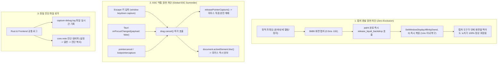

# Liquid & Glass Desktop Capture Lease Architecture

이 문서는 Liquid 및 Glass 테마에서 바탕화면 블러/굴절 텍스처를 캡처할 때 발생하는 **화면 캡처 시 위젯 사라짐(Screenshot Exclusion)**, **드래그 중 캡처 충돌(ESC 미동작 & 배경 탁해짐 현상)**, 그리고 **글로벌 캡처 단축키(Alt+` / ShareX) 충돌 방지 및 진단 로깅 아키텍처**의 근본 원인과 최종 해결책을 정리합니다.

---

## 1. 문제 현상 및 세부 증상

### 1.1 글로벌 캡처 단축키(Alt+` / ShareX) 시 "종종 되고 종종 사라짐"
- 노치를 건드리지 않고 가만히 둔 상태에서는 캡처 화면에 노치가 정상적으로 포함됨.
- 마우스로 노치를 호버하거나 클릭한 직후 0.5초 이내에 캡처 단축키(`Alt + ` `)를 누르면 노치가 캡처에서 사라짐.

### 1.2 캡처 화면에서 ESC 취소 키 먹통 현상
- 노치를 누른 상태(`pointerdown`) 또는 드래그 준비 상태에서 캡처가 실행되면, 캡처 오버레이에서 ESC를 눌러도 취소되지 않음.
- 키보드 포커스가 노치 창에 머물러 있거나 포인터 캡처(`setPointerCapture`)가 OS 레벨에서 잡혀 있어 다른 프로세스로 키가 전달되지 못함.

---

## 2. 근본 기술적 원인 분석 (Deep Root Cause)

### 2.1 "종종 되고 종종 사라짐"의 원인: 400ms 호버 캡처 루프 & 80ms Lease
- 노치 위에 마우스가 올라가면(`pointerenter`), 리퀴드 블러 루프가 400ms 동안 33 FPS로 데스크톱 배경 캡처를 반복합니다.
- 매 캡처마다 80ms 리스가 갱신되므로, **마우스가 닿은 후 최소 480ms 동안 창의 속성이 `WDA_EXCLUDEFROMCAPTURE (0x11)` 상태로 유지**되었습니다.
- 사용자가 `Alt + ` ` 단축키를 누를 때:
  - **마우스 호버 직후(0.5초 이내)**: ShareX는 단축키를 받자마자 메모리 버퍼(`BitBlt`)로 화면을 먼저 캡처합니다. 이 시점에는 아직 `blur` 이벤트가 발생하지 않았으므로, DWM이 노치를 제외한 화면을 넘겨주어 노치가 사라집니다.
  - **0.5초 이상 가만히 둔 후**: 리스가 만료되어 Affinity가 `0`으로 복구되어 있으므로 정상 캡처됩니다.

### 2.2 ESC 먹통의 원인: 포인터 캡처 잔류 & 웹뷰의 ESC 키 미처리
- 마우스 클릭(`pointerdown`) 시 DOM의 `setPointerCapture` 및 Win32 `SetCapture`가 활성화됩니다.
- 글로벌 단축키로 캡처 도구가 열려도 OS 레벨 마우스 캡처가 풀리지 않으면 캡처 도구가 포커스를 가져가지 못합니다.
- 또한 키보드 포커스가 우리 창에 남아 있을 때 사용자가 ESC를 누르면, 웹뷰에 ESC 핸들러가 없어 키를 그냥 무시/삼켜버렸습니다.

---

## 3. 최종 해결 아키텍처 (Zero-Exclusion & Global ESC Surrender)

---

## 4. 정밀 진단 로깅 시스템 (`capture-debug.log`)

문제가 발생했을 때 정확한 원인을 추적할 수 있도록 Rust 백엔드와 프론트엔드가 공통으로 로그 파일에 실시간 기록합니다:

- **로그 파일 위치**:
  - `EconomyWarRoom`: `%LOCALAPPDATA%\EconomyWarRoom\logs\capture-debug.log`
  - `TokenUsage`: `%LOCALAPPDATA%\TokenUsage\logs\capture-debug.log`
- **로그 내용 (밀리초 단위)**:
  - `[AFFINITY] SetWindowDisplayAffinity(0x11 / 0x00) reason=... hwnd=...`
  - `[BACKDROP] capture_liquid_backdrop completed in X ms`
  - `[LEASE] watch_lease: lease expired, restoring affinity to 0`
  - `[POINTER] pointerdown, pointerup, pointercancel, lostpointercapture`
  - `[DRAG] drag.start, drag.cancel with reasons`
  - `[KEY] Escape pressed -> drag.cancel() & yield focus`
  - `[FOCUS] window blur/focus, Tauri onFocusChanged(true/false)`
