# Windows 데스크톱 캡처 리스(Capture Lease) 및 입력 포커스 충돌 해결 가이드
> **부제: 플로팅 위젯, 글래스/리퀴드 블러 앱에서 화면 캡처 시 위젯 증발 및 ESC 키 먹통 현상의 완벽한 해결**

이 문서는 Windows 환경에서 투명/블러(Glass, Liquid, Frosted Glass) 효과를 위해 데스크톱 배경을 실시간 캡처하는 플로팅 앱(Tauri, Electron, WPF, Win32 등)에서 발생하는 **스크린샷 캡처 시 위젯 증발**, **60 FPS 드래그 중 배경 겹침/탁해짐(Hall-of-Mirrors)**, **드래그 이동 후 놓은 직후 캡처 시 사라짐(Settling Cache-Hit Trap)**, 그리고 **캡처 도구 실행 시 ESC 취소 불가 및 포커스 충돌** 문제의 원인 규명과 범용적인 아키텍처 해결책을 정리한 엔지니어링 가이드입니다.

---

## 1. 배경: 왜 이 문제가 발생하는가?

### 1.1 데스크톱 백드롭 캡처와 `WDA_EXCLUDEFROMCAPTURE`
Windows 데스크톱 앱에서 아크릴(Acrylic)이나 Mica 외에 커스텀 렌즈 왜곡, 크로매틱 수차(색수차), 동적 굴절 효과를 내려면 앱 자체에서 노치 뒤의 화면을 GDI `BitBlt`나 DXGI Desktop Duplication API로 직접 캡처해야 합니다.

이때 **자기 자신의 윈도우가 캡처 버퍼에 찍히는 것을 방지**하기 위해 Win32 API인 `SetWindowDisplayAffinity`를 사용합니다:
```c
// 화면 캡처 버퍼에서 이 윈도우를 완전히 제외하도록 DWM에 지시
SetWindowDisplayAffinity(hwnd, WDA_EXCLUDEFROMCAPTURE); // 0x11
```

### 1.2 시스템 레벨의 근본적인 모순 (The Paradox)
1. **렌더링 요구사항**: 내 앱이 바탕화면을 캡처할 때는 내 창이 찍히면 안 되므로 `0x11`이어야 함.
2. **사용자 경험 요구사항**: 사용자가 화면 캡처 도구(Snipping Tool, ShareX, 픽픽, 슬랙/줌/팀즈 화면 공유 등)로 화면을 찍을 때는 내 창이 선명하게 보여야 하므로 `0x00`이어야 함.

이 두 가지 상반된 요구사항을 매끄럽게 조율하지 못하면 아래의 **5대 치명적 결함(Failure Modes)**이 발생합니다.

---

## 2. 5대 결함 증상 및 심층 원인 (Failure Modes)

### 결함 1: 화면 캡처 시 위젯 증발 (The Invisible Window Bug)
- **증상**: 사용자가 `Win + Shift + S`나 `PrintScreen`으로 화면을 캡처하려 할 때 위젯이 감쪽같이 사라지고 투명해짐.
- **원인**:
  - 백그라운드 캡처가 돌아가는 동안 `WDA_EXCLUDEFROMCAPTURE (0x11)`를 끄지 않고 유지함.
  - 마우스 호버(`pointerenter`)나 틱 이벤트 시 불필요하게 캡처 루프를 계속 돌려 창의 친화도가 상시 `0x11`로 고정됨.

### 결함 2: "종종 되고 종종 사라짐" (The Hotkey Race Bug)
- **증상**: 가만히 둔 상태에서 단축키(예: ShareX `Alt + ` `)를 누르면 정상 캡처되지만, 마우스를 노치 위에 올린 직후 누르면 사라짐.
- **원인**:
  - 마우스 호버 시 400ms 동안 33 FPS로 캡처를 돌리며 80ms 리스를 계속 갱신함 (최소 480ms 동안 0x11 고정).
  - ShareX 같은 전문 캡처 도구는 글로벌 핫키(`RegisterHotKey`)를 받자마자 **오버레이 창을 띄우기도 전에 메모리에서 화면을 즉시 캡처(`BitBlt`)**함.
  - 이 찰나의 순간에는 윈도우 포커스 전환이 일어나지 않아 웹뷰에 `blur` 이벤트가 도달하지 못함.
  - 따라서 호버 직후 0.5초 이내에 찍으면 0x11 상태여서 증발하고, 0.5초 이상 가만히 둔 후 찍으면 리스가 만료되어(0x00) 정상 찍히는 기현상이 발생함.

### 결함 3: 노치를 잡고 위치 이동 후 놓은 뒤 캡처 시 사라짐 (The Settling Cache-Hit Trap)
- **증상**: 노치를 끌어서 원하는 위치에 놓은(drop) 뒤 즉시 캡처를 하려고 하면 노치가 사라짐. 몇 초 뒤에 다시 찍으면 보임.
- **원인**:
  - 드래그를 놓은 후 프론트엔드는 400ms 동안 잔여 흔들림/정착을 보정하기 위해 **Settling Loop**(33ms~100ms 주기)를 실행함.
  - 노치가 이미 정지했으므로 백그라운드 캡처 시 **직전 프레임과 픽셀이 100% 동일(Cache Hit)**하여 백엔드가 `Vec::new() (0 bytes)`를 반환함.
  - 프론트엔드는 0바이트 프레임이 오면 `frames` 배열에 넣지 않아 `painted = false`가 됨.
  - 기존 코드에서 친화도 해제(`release_liquid_backdrop`)가 `if (painted)` 내부에 존재하여, **0바이트 캐시 히트 프레임에서는 릴리즈 함수가 절대 호출되지 않음**.
  - 동시에 Settling 루프가 33ms마다 새 캡처를 요청하여 백엔드 리스 만료 타이머(`renewed = Instant::now()`)를 계속 갱신함.
  - **결과: 노치를 놓은 뒤 400ms 전체 시간 동안 0x11이 영구 고정되어 이 타이밍에 캡처하면 100% 증발함.**

### 결함 4: 캡처 화면에서 ESC 취소 키 먹통 (The Trapped Focus Bug)
- **증상**: 노치를 드래그하려 했거나 클릭한 상태에서 캡처 도구를 실행하면, 캡처 화면에서 ESC를 눌러도 취소되지 않고 전체화면이 굳음.
- **원인**:
  - 드래그 추적을 위해 브라우저 DOM의 `element.setPointerCapture()` 및 Win32 `SetCapture`가 활성화됨.
  - Windows OS는 **마우스 캡처를 독점하고 있는 창이 있으면 타 프로세스로의 포커스 전환(`SetForegroundWindow`)을 원천 차단**함.
  - 캡처 도구의 전체화면 창이 포커스를 가져가지 못하고, 키보드 입력(ESC)이 우리 웹뷰로 유입되나 웹뷰에 ESC 핸들러가 없어 키가 삼켜짐.

### 결함 5: 배경 탁해짐 및 잔상 겹침 (Hall-of-Mirrors Feedback Loop)
- **증상**: 드래그 이동 중 캡처를 시도한 뒤부터 노치 배경이 점점 어두워지고 여러 겹이 겹쳐 보임.
- **원인**:
  - 캡처 증발을 막겠다고 60 FPS 드래그 중 매 프레임마다 `0x11` 켜고 직후 `0x00` 끄기를 반복함 (초당 120회 토글).
  - `SetWindowDisplayAffinity`는 DWM과의 비동기 IPC 통신이므로 초당 120회 토글을 DWM이 실시간으로 따라오지 못함.
  - 창 제외가 미처 적용되지 않은 프레임에서 `BitBlt`가 자기 자신을 캡처하고, 다음 프레임에서 블러된 자기 자신을 다시 캡처하여 재블러하는 **무한 거울 피드백 루프**가 발생함.

---

## 3. 완벽한 해결 아키텍처: Zero-Exclusion & Graceful Surrender

```mermaid
flowchart TD
    subgraph BackendSync ["1. Rust 백엔드 즉각 동기 반납 (Zero-Exclusion)"]
        A["capture_liquid_backdrop(dragging: Option<bool>)"] --> B{"dragging == true?"}
        B -- "No (정적/정착/호버)" --> C["BitBlt 화면 캡처 완료"]
        C --> D["InFlight 가드 즉각 drop"]
        D --> E["Rust 백엔드 내부에서 즉시 release_liquid_backdrop() 실행"]
        E --> F["DWM 0x00 복원 (소요시간 < 1ms, IPC 대기 없음)"]
        B -- "Yes (60 FPS 드래그)" --> G["안정적 Lease 유지 (120Hz 깜빡임 방지)"]
    end

    subgraph NativeComplete ["2. 드래그 완료 시 즉각 강제 해제"]
        H["complete_drag (드래그 종료 / 마우스 놓음)"] --> I["Rust에서 즉시 release_liquid_backdrop(main) 호출"]
        I --> J["Settling 루프 진입 전 0x00 즉각 복원"]
    end

    subgraph FrontendSafeguard ["3. 프론트엔드 무조건 릴리즈 (Cache-Hit 방어)"]
        K["paint(frames)"] --> L{"!isDragging?"}
        L -- "Yes" --> M["painted 여부/0바이트 무관하게 release_liquid_backdrop 호출"]
    end

    subgraph InputSurrender ["4. Global ESC & Input Surrender (ESC 먹통 방지)"]
        N["Escape 키 / window blur / pointercancel"] --> O["drag.cancel() 즉각 호출"]
        O --> P["releasePointerCapture() -> 마우스 독점 강제 반납 (try-catch 보호)"]
        O --> Q["document.activeElement.blur() -> 포커스 즉시 양보"]
        O --> R["release_liquid_backdrop() 즉시 호출"]
    end
```



---

## 4. 프레임워크 무관 구현 체크리스트 (Implementation Guide)

유사 앱을 개발 중인 타 팀이나 회사 솔루션에 바로 적용할 수 있는 핵심 구현 수칙입니다.

### 4.1 백엔드 (Rust / C++ / C# Win32 공통)

1. **정적 프레임 캡처 시 즉시 반납**:
   - `BitBlt`가 끝난 직후 또는 프론트엔드가 페인트를 마친 즉시 `SetWindowDisplayAffinity(hwnd, 0)`을 호출하십시오.
   - 단일 프레임 캡처 시 윈도우가 0x11에 머무는 시간은 **15ms 미만**이어야 합니다.
2. **연속 드래그 중에는 Lease(리스)로 보호**:
   - 60 FPS 드래그 중에는 매 프레임 껐다 켜지 말고 80ms 유효기간을 가진 리스(`Instant::now() + 80ms`)를 유지하십시오.
3. **`DwmFlush()` 동기화 필수**:
   - `SetWindowDisplayAffinity(hwnd, WDA_EXCLUDEFROMCAPTURE)` 호출 직후 반드시 `DwmFlush()`를 호출하여 DWM이 창 제외를 컴포지션 버퍼에 커밋한 후 `BitBlt`를 수행하십시오.

```rust
// Rust / Tauri 예시
if guard.lease.is_none() {
    set_affinity(hwnd, WDA_EXCLUDEFROMCAPTURE)?;
    unsafe { DwmFlush()?; } // DWM 반영 보장
}
let bytes = capture_desktop_pixels(...);
```

### 4.2 프론트엔드 (TypeScript / React / Vue / Vanilla JS)

1. **정적 렌더링 완료 즉시 릴리즈 호출**:
   ```typescript
   paint: (frames) => {
     renderToCanvas(frames);
     // 드래그 중이 아니면 캔버스에 그리자마자 백엔드 친화도를 0으로 즉시 반납
     if (!isDragging) {
       invoke("release_liquid_backdrop");
     }
   }
   ```

2. **전역 ESC 키 이벤트 인터셉트 및 포커스 항복**:
   - 캡처 단계(`{ capture: true }`)에서 ESC를 감지하여 포인터 캡처를 풀고 활성 요소를 블러하십시오.
   ```typescript
   window.addEventListener("keydown", (e) => {
     if (e.key === "Escape") {
       drag.cancel(); // releasePointerCapture() 호출
       (document.activeElement as HTMLElement | null)?.blur(); // 포커스 양보
     }
   }, { capture: true });
   ```

3. **OS 레벨 포커스 상실 이벤트 처리**:
   - DOM의 `blur` 뿐만 아니라 윈도우 프레임워크의 네이티브 포커스 이벤트(Tauri `onFocusChanged`, Electron `browserWindow.on('blur')`)에서도 포인터 캡처를 강제 해제하십시오.
   ```typescript
   getCurrentWindow().onFocusChanged(({ payload: focused }) => {
     if (!focused) {
       drag.cancel();
       (document.activeElement as HTMLElement | null)?.blur();
     }
   });
   ```

4. **모든 비정상 포인터 이벤트 핸들링**:
   - `lostpointercapture`와 `pointercancel`이 발생하면 세션을 끝내지 말고 즉시 `drag.cancel()`을 호출하십시오.

### 4.3 회귀 방지를 위한 캡처 시나리오 테스트 케이스 (TC Matrix)

유사 앱에서 동일한 회귀 버그가 재발하지 않도록 아래 6대 시나리오를 자동화 테스트(Unit/Integration)로 반드시 구축하십시오:

| TC ID | 시나리오 | 검증 내용 | 기대 결과 |
|:---|:---|:---|:---|
| **TC-CAP-01** | **정착 루프 0바이트 캐시 히트** | 드래그 종료 직후 400ms 동안 동일 배경에 대해 `bytes == 0`이 반환될 때 `!isDragging` 조건으로 릴리즈 호출 여부 | `painted` 여부와 무관하게 `release_liquid_backdrop`이 즉시 호출되어 0x00 복원 |
| **TC-CAP-02** | **백엔드 동기 즉각 반납** | `dragging: false` (호버, 정적 프레임) 상태에서 프레임 캡처 완료 시 백엔드 동작 | Rust/C++ 백엔드가 `frame.await` 종료 직후 IPC 대기 없이 즉시 `SetWindowDisplayAffinity(0x00)` 실행 |
| **TC-CAP-03** | **드래그 종료 네이티브 릴리즈** | 마우스 버튼 릴리즈 시 네이티브 `complete_drag` 핸들러 실행 | `complete_drag` 내부에서 백엔드 리스 파기 및 즉각 0x00 복원 |
| **TC-CAP-04** | **ESC 키 입력 즉시 포커스 양보** | 드래그 중 Escape 키 입력 시 | 포인터 캡처 즉각 해제 (`releasePointerCapture`), `drag.cancel()` 실행, 활성 요소 `blur()`, 백드롭 릴리즈 호출 |
| **TC-CAP-05** | **윈도우 Blur / 포커스 상실** | 캡처 단축키 등으로 윈도우 포커스 상실 시 (`blur`, `onFocusChanged(false)`) | 진행 중 드래그 즉시 취소, 정착 타이머 리셋(`lastChangedAt = 0`), 백드롭 즉시 릴리즈 |
| **TC-CAP-06** | **포인터 캡처 예외 방어** | 타 프로세스 창 활성화 등으로 `releasePointerCapture` 호출 시 DOMException 발생 상황 | 예외가 catch되어 후속 `finish(true)` 및 `release_liquid_backdrop` 호출이 차단되지 않음 |

---

## 5. 정밀 진단 로깅 구축 가이드 (`capture-debug.log`)

문제가 발생했을 때 "단축키가 언제 눌렸고, 그때 창 친화도가 무엇이었는지" 1초 만에 규명할 수 있는 로깅 포맷입니다.

### 5.1 로그 표준 포맷
```text
[2026-10-24 13:30:38.950] [AFFINITY] SetWindowDisplayAffinity(0x11) reason=capture_start hwnd=0xD091A
[2026-10-24 13:30:38.962] [AFFINITY] SetWindowDisplayAffinity(0x00) reason=release_backdrop hwnd=0xD091A
[2026-10-24 13:30:42.100] [POINTER] pointerdown id=1 button=0
[2026-10-24 13:30:42.101] [DRAG] start() sessionId=123 pointerId=1 acquired setPointerCapture
[2026-10-24 13:30:42.500] [KEY] Escape pressed -> drag.cancel() & yield focus
[2026-10-24 13:30:42.501] [DRAG] cancel() called -> releasing pointer capture
[2026-10-24 13:30:42.502] [POINTER] releasePointerCapture id=1
[2026-10-24 13:30:42.503] [FOCUS] onFocusChanged payload=false
```

### 5.2 진단 체크리스트
- **0x11 상태 지속 시간**: `capture_start`부터 `release_backdrop`까지의 차이가 20ms 미만이어야 합니다.
- **ESC 입력 시 반응**: `[KEY] Escape pressed` 직후 즉각 `releasePointerCapture`가 기록되어야 합니다.

---

## 6. 결론 및 요약

플로팅 블러 위젯에서 화면 캡처 충돌을 방지하는 황금률은 네 가지입니다:
1. **0x11은 화면을 캡처하는 딱 1ms 동안만 켜고 백엔드에서 즉시 0x00으로 복구할 것 (Zero-Exclusion).**
2. **연속 드래그 중에는 120Hz 진동을 피하고 리스(Lease)를 안정적으로 유지하되, 드래그 종료 즉시 0x00을 강제할 것.**
3. **정착(Settling) 루프의 0바이트 캐시 히트 프레임에서도 예외 없이 백드롭 리스를 해제할 것.**
4. **ESC 키, `blur`, 포커스 상실 발생 시 모든 마우스 포인터 캡처를 즉시 반납하고 포커스를 양보할 것 (Graceful Surrender).**
