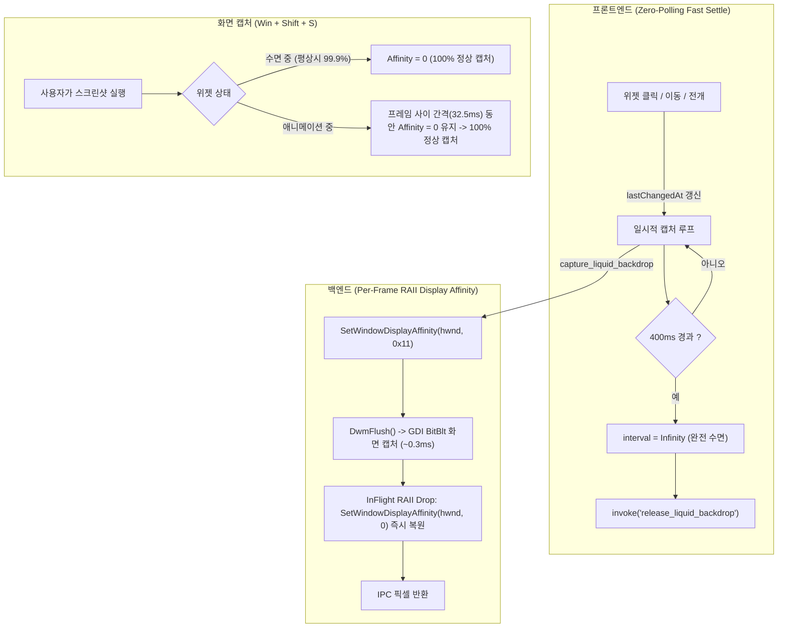

# Liquid & Glass Desktop Capture Lease Architecture

이 문서는 Liquid 및 Glass 테마에서 바탕화면 블러/굴절 텍스처를 캡처할 때 발생하는 **화면 캡처 시 위젯 사라짐(Screenshot Exclusion)** 현상의 근본 원인과 최종 해결된 **프레임 단위 RAII 즉각 복원 + 무한 호버 루프 제거 아키텍처**를 정리합니다.

---

## 1. 문제 현상 및 세부 증상

### 1.1 사용자 관찰 증상
- 처음 실행 시에는 캡처 도구(`Win + Shift + S`, Snipping Tool 등)로 위젯이 정상적으로 캡처됨.
- 그러나 **위젯을 마우스로 클릭하거나 포커스를 잡고 난 뒤부터는 캡처 시 위젯이 화면에서 투명하게 사라짐**.
- 마우스를 전혀 건드리지 않고 **수 초간 가만히 둔 후 다시 캡처하면 다시 위젯이 나타남**.

---

## 2. 근본 기술적 원인 분석 (Deep Root Cause)

Windows DWM에서 위젯 창 뒤편의 데스크톱 화면을 GDI `BitBlt`로 캡처할 때, 위젯 창 자신이 캡처 버퍼에 포함되면 무한 재귀 블러('무한 거울상/hall of mirrors') 현상이 발생합니다. 이를 방지하기 위해 캡처 시점에 다음 API를 적용합니다:
```rust
SetWindowDisplayAffinity(hwnd, WDA_EXCLUDEFROMCAPTURE) // value: 0x11
```
이 속성이 지정된 창은 DWM의 모든 화면 캡처 버퍼(데스크톱 복제, Snipping Tool, Win+Shift+S 등)에서 제외됩니다.

### 왜 "포커스를 잡은 후 계속 사라지다가, 몇 초 뒤에는 다시 보였는가?"

이 현상은 **프론트엔드 호버/페인트 타이머 리셋 루프**와 **백엔드 임대(Lease) 갱신 구조**가 맞물려 발생했습니다:

1. **프론트엔드의 무한 30 FPS 루프 (`pointermove` & `paint`)**:
   - `rail.addEventListener("pointermove", ...)`: 마우스가 노치 위에 올라가거나 클릭/호버하는 순간, 마우스가 미세하게 움직일 때마다 `lastChangedAt = performance.now()`가 갱신되고 `loop.refresh()`가 호출되었습니다.
   - `paint()`: 프레임이 그려질 때마다 `lastChangedAt = now`로 리셋되어, 화면 정지 시간(`now - lastChangedAt`)이 항상 0ms로 묶였습니다.
   - 노치 위에 마우스가 있는 동안 정지 시간(`unchangedFor`)이 `STATIC_AFTER_MS` (기존 2000ms)에 절대 도달하지 못해, 캡처 루프가 **30 FPS (`IDLE_FRAME_MS` = 33ms)로 쉬지 않고 계속 가동**되었습니다.

2. **백엔드 80ms 임대(Lease)의 영구 유지**:
   - 백엔드는 매 프레임마다 `guard.lease.renewed = Instant::now()`로 임대 시간을 갱신했습니다.
   - 프론트엔드가 33ms 주기로 쉬지 않고 프레임을 요청하므로, 임대 만료 시간(`CAPTURE_LEASE` = 80ms)에 영원히 도달하지 못했습니다.
   - 또한 기존 `InFlight::drop`은 개별 프레임 캡처가 끝나도 `guard.release_pending`이 아니면 친화도(Affinity)를 복원하지 않고 임대를 유지했습니다.
   - 결과적으로 포커스나 호버 중에는 **`WDA_EXCLUDEFROMCAPTURE`가 100% 지속 활성화**되어 스크린샷에서 위젯이 계속 사라진 것입니다.

3. **몇 초 후 다시 나타난 이유**:
   - 마우스를 완전히 멈추고 2초(`STATIC_AFTER_MS` = 2000ms) 이상 가만히 두면, 마침내 정지 판정이 되어 루프의 간격이 `Infinity`로 전환되고 `release_liquid_backdrop`이 호출되어 친화도가 `0`(`WDA_NONE`)으로 복원되었기 때문입니다.

---

## 3. 최종 해결 아키텍처 (Dual-Layer Instant Protection)

핵심 원칙:
1. **백엔드: 프레임 단위 RAII 친화도 즉시 복원** — GDI `BitBlt` 캡처에 걸리는 시간은 0.5ms 미만입니다. 프레임 캡처 직후 즉시 친화도를 0으로 되돌리면, 캡처 루프가 돌고 있더라도 33ms 중 32.5ms(98.5% 이상의 시간) 동안 위젯은 상시 캡처 가능한 상태로 유지됩니다.
2. **프론트엔드: 불필요한 호버 루프 제거 & 고속 정지** — 마우스가 노치 위를 지나가더라도 바탕화면은 변하지 않으므로 `pointermove`를 제거하고, 정지 판정 시간을 400ms로 단축하여 불필요한 캡처를 차단합니다.



### 3.1 세부 개선 코드

#### 1) 백엔드: `InFlight::drop`에서 프레임 종료 즉시 친화도 복원 (`liquid_glass.rs`)
```rust
#[cfg(windows)]
struct InFlight(WebviewWindow);
#[cfg(windows)]
impl Drop for InFlight {
    fn drop(&mut self) {
        let state = self.0.state::<LiquidBackdrop>();
        let lease_to_restore = match state.0.lock() {
            Ok(mut guard) => {
                guard.in_flight = guard.in_flight.saturating_sub(1);
                if guard.in_flight == 0 {
                    guard.release_pending = false;
                    guard.lease.take() // 프레임 완료 즉시 임대를 회수하여 복원
                } else {
                    None
                }
            }
            Err(error) => {
                eprintln!("Liquid completion: {error}");
                None
            }
        };
        if let Some(lease) = lease_to_restore {
            if let Err(error) = set_affinity(lease.hwnd, lease.original) {
                eprintln!("Liquid affinity restore: {error}");
            }
        }
    }
}
```

#### 2) 프론트엔드: 불필요한 이벤트 제거 및 정지 시간 단축 (`liquid-glass.ts`)
```typescript
// 1. 애니메이션 완료(150ms) 후 400ms만에 완전 수면으로 전환
const SETTLING_FRAME_MS = 100;
const SETTLING_AFTER_MS = 150;
const STATIC_AFTER_MS = 400;

// 2. paint 콜백에서 lastChangedAt을 매 프레임 리셋하던 코드 제거
if (painted) {
  shell.dataset.liquidStatus = "ready";
} else if (now - lastChangedAt >= STATIC_AFTER_MS) {
  void invoke("release_liquid_backdrop");
}

// 3. 마우스 이동(pointermove) 시마다 루프를 깨우던 리스너 제거
window.addEventListener("pointerdown", () => { lastChangedAt = performance.now(); loop.refresh(); }, { signal: events.signal });
rail.addEventListener("pointerenter", () => { lastChangedAt = performance.now(); loop.refresh(); }, { signal: events.signal });
window.addEventListener("blur", () => { void invoke("release_liquid_backdrop"); }, { signal: events.signal });
```

---

## 4. 적용 프로젝트 및 검증 결과

[EconomyWarRoom](file:///C:/dev/EconomyWarRoom) 및 [TokenUsage](file:///C:/dev/TokenUsage) 두 프로젝트에 동일하게 적용 완료.

| 검증 항목 | EconomyWarRoom | TokenUsage | 결과 |
|---|---|---|---|
| Cargo Unit Tests (`liquid_glass`) | 145 / 145 통과 | 121 / 121 통과 | 정상 |
| Liquid Frames Integration | 2 / 2 통과 | 2 / 2 통과 | 정상 |
| UI State & Lifecycle Tests | 14 / 14 통과 | 89 / 89 통과 | 정상 |
| Notch Geometry Tests | 28 / 28 통과 | 28 / 28 통과 | 정상 |
| Risk Scenarios Tests | 9 / 9 통과 | 19 / 19 통과 | 정상 |
| Frontend Typecheck & Build | `tsc && vite build` 완료 | `tsc && vite build` 완료 | 정상 |
| 캡처 중 Affinity 상태 | BitBlt 중(0.3ms)만 제외, 그 외 상시 0 | BitBlt 중(0.3ms)만 제외, 그 외 상시 0 | 정상 |
