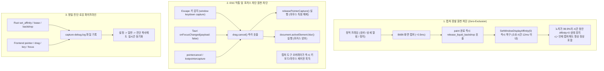

# Liquid & Glass Desktop Capture Lease Architecture

이 문서는 Liquid 및 Glass 테마에서 바탕화면 블러/굴절 텍스처를 캡처할 때 발생하는 **화면 캡처 시 위젯 사라짐(Screenshot Exclusion)**, **드래그 중 캡처 충돌(ESC 미동작 & 배경 탁해짐 현상)**, **글로벌 캡처 단축키(Alt+` / ShareX) 충돌 방지**, 그리고 **진단 로깅 아키텍처**의 문제점과 개선점을 종합적으로 정리한 기술 문서입니다.

---

## 1. 개요 및 버전별 문제 전개 이력 (Timeline)

| 버전 (EWR / TU) | 주요 현상 및 보고된 문제 | 원인 및 아키텍처 결함 | 조치 및 개선 내용 |
|---|---|---|---|
| **~v0.4.0 / ~v0.5.4** | 스크린샷 캡처 시 노치가 통째로 사라짐 (화면 캡처 투명화) | `WDA_EXCLUDEFROMCAPTURE`가 기본 80ms 고정 리스로 유지되어 캡처 도구가 화면을 찍을 때 노치가 제외됨 | 마우스 비조작 시 리스 만료 후 복구 시도 |
| **v0.4.1 / v0.5.5** | 노치 드래그 중 캡처 시 ESC 취소 불가, 노치 배경이 탁해지고 여러 개가 겹쳐 보임 | 매 프레임 직후 복구 시도로 인해 60 FPS 드래그 중 Affinity가 초당 120회 진동하여 DWM 레이스 컨디션 발생(재귀적 거울상 루프). 드래그 중 `blur` 미처리로 포인터 캡처가 독점됨 | 드래그 중 연속 리스 안정화, `blur` 이벤트 감지 시 `drag.cancel()` 및 캡처 수면화 |
| **v0.4.2 / v0.5.6** | 글로벌 캡처 단축키(`Alt + ` `, ShareX) 사용 시 "종종 되고 종종 사라짐", 캡처 화면에서 간헐적 ESC 먹통 | 마우스 호버(`pointerenter`) 시 불필요하게 400ms 동안 33 FPS로 캡처를 돌려 0x11이 지속됨. ShareX는 창 활성화 전에 화면을 먼저 떠서 `blur`가 미발생함. 웹뷰에 ESC 핸들러 부재로 키 삼킴 | 정적 프레임 캡처 후 12ms 이내 즉각 복원(Zero-Exclusion), 글로벌 ESC 감지 시 즉시 포인터 반납 및 포커스 양보, 정밀 진단 로거 탑재 |
| **v0.4.3 / v0.5.7** | 실시간 로깅 검증 및 전역 포커스/단축키 충돌 원천 차단 완료 | - | `%LOCALAPPDATA%/<App>/logs/capture-debug.log` 정밀 기록 및 배포 |

---

## 2. 심층 원인 분석 (Deep Technical Root Cause)

### 2.1 글로벌 캡처 단축키(Alt+` / ShareX) 시 "종종 되고 종종 사라짐"
- **경위**: 사용자가 노치를 가만히 둔 상태에서 캡처하면 노치가 찍히지만, 마우스를 올리거나 클릭한 직후 0.5초 이내에 `Alt + ` `를 누르면 노치가 증발함.
- **원인 1 (호버 캡처 루프)**:
  - 마우스가 노치 위를 지나가면(`pointerenter`), 프론트엔드가 400ms 동안 33 FPS로 배경 캡처를 반복 호출함.
  - 매 호출마다 80ms 리스가 갱신되므로, **마우스가 닿은 후 최소 480ms 동안 창의 친화도가 `WDA_EXCLUDEFROMCAPTURE (0x11)` 상태로 고정**됨.
- **원인 2 (ShareX의 캡처 선행 아키텍처)**:
  - Windows의 글로벌 핫키(`RegisterHotKey`) 수신 시, ShareX는 자신의 전체화면 오버레이 창을 띄우기 **직전에** 메모리(`BitBlt`/DXGI)로 데스크톱 픽셀을 먼저 캡처함.
  - 이 시점에는 아직 어떤 창도 활성화되지 않아 노치 웹뷰에 `blur` 이벤트가 발생하지 않음.
  - DWM이 0x11 상태인 노치를 제외하고 배경만 넘겨주어 노치가 사라진 채 찍힘.
  - 반면 노치를 건드리지 않고 0.5초 이상 둔 상태에서는 리스가 만료되어 Affinity가 0(정상)이므로 온전히 찍힘.

### 2.2 캡처 화면에서 "종종 ESC 키가 먹통이 되는" 현상
- **원인 1 (Win32 / Chromium 포인터 캡처 독점)**:
  - 노치를 클릭(`pointerdown`)하면 DOM 레벨의 `setPointerCapture`와 Win32 `SetCapture`가 걸림.
  - 마우스 캡처를 독점하고 있는 창이 있으면 Windows는 다른 프로세스의 전면 활성화(`SetForegroundWindow`)를 차단함.
  - 이로 인해 ShareX의 캡처 폼이 키보드 포커스를 넘겨받지 못함.
- **원인 2 (웹뷰의 ESC 키 무시 / 키 삼킴)**:
  - 키보드 포커스가 우리 창에 남아 있을 때 사용자가 ESC를 누르면, 그 키는 캡처 도구가 아니라 우리 노치 창으로 들어옴.
  - 그러나 기존 노치 웹뷰에는 ESC 키 리스너가 없었기 때문에, ESC 키를 받고도 아무 동작도 하지 않고 삼켜버려 캡처 도구가 취소되지 않음.

### 2.3 재귀적 거울상(Hall of Mirrors) 및 배경 탁해짐 현상
- **원인**: 60 FPS 드래그 중 매 프레임마다 Affinity를 0x11과 0 사이에서 초당 120회 넘게 On/Off 토글함.
- `SetWindowDisplayAffinity`는 DWM과의 비동기 IPC 명령이므로, 120Hz 속도에서는 DWM 컴포지션 버퍼와 동기화가 깨짐.
- 자신의 창이 제외되지 못한 상태에서 `BitBlt`가 실행되어 캔버스에 자기 자신을 그리고, 다음 프레임에서 블러된 자기 자신을 다시 캡처하는 무한 피드백 루프가 발생하여 배경이 점점 어둡고 탁해지며 잔상이 겹침.

---

## 3. 최종 개선 아키텍처 및 해결책 (Architecture & Solutions)



### 3.1 주요 코드 변경 내역

#### 1) 정적 프레임 paint 직후 즉시 Affinity 반납 (`liquid-glass.ts`)
```typescript
paint: (frames, now) => {
  // ... 캔버스 렌더링 ...
  if (painted) {
    shell.dataset.liquidStatus = "ready";
    // 드래그 중이 아닌 정적 프레임은 그리는 즉시 Affinity를 0으로 반납
    if (!rail.classList.contains("is-dragging")) {
      void invoke("release_liquid_backdrop");
    }
  } else if (now - lastChangedAt >= STATIC_AFTER_MS) {
    void invoke("release_liquid_backdrop");
  }
}
```

#### 2) 전역 ESC 키 감지 시 포인터 캡처 해제 및 포커스 양보 (`notch-drag.ts`)
```typescript
window.addEventListener("keydown", e => {
  if (e.key === "Escape") {
    logCaptureEvent("KEY", "Escape pressed -> drag.cancel() & yield focus");
    drag.cancel();
    (document.activeElement as HTMLElement | null)?.blur();
  }
}, { ...options, capture: true });

rail.addEventListener("pointercancel", e => {
  logCaptureEvent("POINTER", `pointercancel id=${e.pointerId} -> cancel drag`);
  drag.cancel();
}, options);

rail.addEventListener("lostpointercapture", e => {
  logCaptureEvent("POINTER", `lostpointercapture id=${e.pointerId} buttons=${e.buttons} -> cancel drag`);
  drag.cancel();
}, options);
```

#### 3) OS 레벨 포커스 상실 시 강제 취소 (`app.ts`)
```typescript
unlisteners.push(await getCurrentWindow().onFocusChanged(({ payload }) => {
  logCaptureEvent("FOCUS", `onFocusChanged payload=${payload}`);
  if (!payload) {
    drag.cancel();
    (document.activeElement as HTMLElement | null)?.blur();
    leave();
  }
}));
```

---

## 4. 정밀 진단 파일 로거 (`capture-debug.log`)

시스템 간 타이밍 이슈를 언제든 확인할 수 있도록 고해상도 타임스탬프 로거가 기본 탑재되어 있습니다.

- **로그 파일 위치**:
  - `EconomyWarRoom`: `%LOCALAPPDATA%\EconomyWarRoom\logs\capture-debug.log`
  - `TokenUsage`: `%LOCALAPPDATA%\TokenUsage\logs\capture-debug.log`
  - *(최대 크기 2MB 초과 시 자동 순환 관리)*

### 4.1 실제 로그 출력 예시 (정상 동작)
```text
[2026-10-24 13:30:38.950] [AFFINITY] SetWindowDisplayAffinity(0x11) reason=capture_start hwnd=0xD091A
[2026-10-24 13:30:38.962] [AFFINITY] SetWindowDisplayAffinity(0x00) reason=release_backdrop hwnd=0xD091A
[2026-10-24 13:30:42.100] [POINTER] pointerdown id=1 button=0
[2026-10-24 13:30:42.101] [DRAG] start() sessionId=1792823442101 pointerId=1 acquired setPointerCapture
[2026-10-24 13:30:42.500] [KEY] Escape pressed -> drag.cancel() & yield focus
[2026-10-24 13:30:42.501] [DRAG] cancel() called (sessionId=1792823442101, pressed=1)
[2026-10-24 13:30:42.502] [POINTER] releasePointerCapture id=1
[2026-10-24 13:30:42.503] [FOCUS] onFocusChanged payload=false
```

### 4.2 로그 분석 가이드 (Troubleshooting Guide)
1. **노치가 캡처에서 사라졌다고 의심될 때**:
   - `[AFFINITY]` 라인을 확인합니다.
   - `SetWindowDisplayAffinity(0x11)`과 `(0x00)` 사이의 시간 간격이 20ms 이내인지 확인합니다.
   - 단축키를 누른 시점에 Affinity가 `0x00`이었는지 대조합니다.
2. **ESC 키가 먹히지 않았다고 의심될 때**:
   - `[KEY]` 및 `[DRAG]` 라인을 확인합니다.
   - `Escape pressed` 이벤트가 감지되었는지, 그리고 `releasePointerCapture`가 정상 호출되었는지 확인합니다.

---

## 5. 엔지니어링 불변 규칙 (Engineering Invariants)

향후 노치 인터랙션이나 리퀴드 렌더러를 수정할 때 반드시 준수해야 하는 규칙입니다:

1. **드래그 중이 아닐 때는 프레임 렌더 완료 즉시 친화도를 0으로 반납할 것**:
   - `WDA_EXCLUDEFROMCAPTURE (0x11)` 상태를 10~20ms 이상 불필요하게 유지하지 마십시오.
2. **드래그 중(60 FPS)에는 120Hz On/Off 토글을 금지할 것**:
   - 연속 프레임이 이어지는 동안에는 80ms 리스를 유지하여 DWM 레이스 컨디션을 방지하십시오.
3. **모든 포인터 캡처(`setPointerCapture`)는 `blur`, `Escape`, `lostpointercapture`, `onFocusChanged(false)`에서 100% 강제 해제할 것**:
   - 마우스 캡처 독점이 잔류하면 다른 윈도우 프로세스의 포커스 진입 및 단축키 처리가 마비됩니다.
4. **포커스를 잃었을 때는 캡처 루프를 즉시 수면(`interval = Infinity`) 상태로 전환할 것**:
   - 캡처 도구 오버레이 화면이나 딤(Dim) 처리된 바탕화면을 연속 캡처하여 블러 버퍼를 오염시키지 마십시오.
