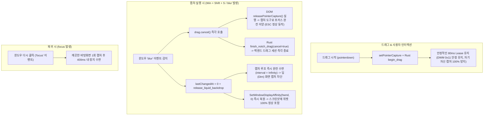

# Liquid & Glass Desktop Capture Lease Architecture

이 문서는 Liquid 및 Glass 테마에서 바탕화면 블러/굴절 텍스처를 캡처할 때 발생하는 **화면 캡처 시 위젯 사라짐(Screenshot Exclusion)** 및 **드래그 중 캡처 충돌(ESC 미동작 & 배경 탁해짐 현상)**의 근본 원인과 최종 해결된 아키텍처를 정리합니다.

---

## 1. 문제 현상 및 세부 증상

### 1.1 포커스/호버 후 위젯 사라짐 현상
- 앱 기동 직후에는 스크린샷에 위젯이 정상 캡처되나, 노치를 클릭하거나 마우스를 올린 직후에는 스크린샷(`Win + Shift + S`, Snipping Tool)에서 위젯이 사라짐.
- 마우스를 수 초간 가만히 두면 다시 캡처에 나타남.

### 1.2 드래그 중 캡처 시 ESC 취소 불가 및 배경 탁해짐/겹침 현상
- 노치를 마우스로 잡고 위치 이동(드래그)을 하던 도중 `Win + Shift + S` 등으로 캡처를 실행하면 **ESC 키로 캡처가 취소되지 않음**.
- 이후 노치 배경이 **비정상적으로 탁해지고 여러 프레임이 겹쳐 보이는(Hall-of-Mirrors 재귀 블러) 현상** 발생.

---

## 2. 근본 기술적 원인 분석 (Deep Root Cause)

### 2.1 ESC 취소 불가 원인: 포인터 캡처(Pointer Capture) 미해제
- 드래그 시작 시 웹뷰의 `rail` 요소는 마우스 추적을 위해 `element.setPointerCapture(pointerId)` 및 Win32 `SetCapture`를 활성화합니다.
- 사용자가 드래그 도중 `Win + Shift + S`를 누르면 Windows 캡처 오버레이(`ScreenClippingHost.exe`)가 화면을 덮으며 우리 윈도우에 `blur` 이벤트가 발생합니다.
- 그러나 기존 드래그 핸들러는 `blur` 이벤트를 감지하지 않아 **포인터 캡처(`PointerCapture`)가 해제되지 않은 채 유지**되었습니다.
- 포인터 캡처가 잠겨있으면 Windows의 키보드/마우스 포커스가 `ScreenClippingHost.exe`로 완전히 이양되지 못해, 사용자가 누른 **ESC 키가 캡처 도구로 전달되지 않고 무시**된 것입니다.

### 2.2 배경 탁해짐 및 겹침 현상 원인: 120Hz 친화도 토글 & 캡처 도구 오버레이 중복 캡처
1. **프레임 단위 친화도 토글(120Hz)로 인한 DWM 동기화 실패**:
   - 60 FPS 드래그 중 매 프레임마다 `InFlight::drop`에서 친화도를 0으로 되돌리고 다음 프레임(16ms 뒤)에서 다시 0x11로 변경하는 방식을 사용하면, 1초에 120회에 달하는 비동기 DWM IPC 호출이 발생합니다.
   - DWM이 창 제외(0x11)를 미처 합성하기 전에 GDI `BitBlt`가 화면을 읽으면서, **위젯 창 자신의 이전 렌더링 픽셀이 캡처 버퍼에 포함**되었습니다.
   - 캔버스에 그려진 자신의 모습이 다음 프레임에서 또다시 캡처되어 블러 필터가 덧씌워지는 **재귀적 거울상(Hall-of-Mirrors) 루프**가 발생하여 배경이 어둡고 탁하게 변하며 여러 겹으로 겹쳐 보인 것입니다.
2. **캡처 도구 활성 중 무차별 백그라운드 캡처 지속**:
   - 캡처 도구가 열려 창이 포커스를 잃었음에도(`blur`) 드래그 플래그(`is-dragging`)가 해제되지 않아, 어둡게 딤(Dim) 처리된 캡처 도구의 오버레이 화면을 60 FPS로 계속 캡처하여 캔버스에 덧칠했습니다.

---

## 3. 최종 해결 아키텍처 (Robust Blur-Safety & Stable Lease)



### 3.1 세부 개선 코드

#### 1) 드래그 세션: `blur` 시 포인터 캡처 즉각 해제 (`notch-drag.ts`)
```typescript
export function createNotchDrag(handlers: DragHandlers) {
  // ...
  return {
    cancel() {
      if (sessionId === null && pressed === null) return;
      armed = dragging = false;
      pressed = null;
      releaseCapture(); // element.releasePointerCapture() 호출
      paint();
      finish(true);     // Rust 백엔드 드래그 세션 취소
      sessionId = null;
    },
    // ...
  };
}

// mountNotchDrag: 윈도우 포커스 아웃 즉시 드래그 및 포인터 캡처 해제
window.addEventListener("blur", () => drag.cancel(), options);
```

#### 2) 리퀴드 캡처: `blur` 시 루프 즉시 수면 & `focus` 시 갱신 (`liquid-glass.ts`)
```typescript
window.addEventListener("blur", () => {
  lastChangedAt = 0; // 정지 시간을 초과시켜 interval = Infinity로 즉시 전환
  void invoke("release_liquid_backdrop"); // 친화도 0으로 즉시 복원
  loop.refresh();
}, { signal: events.signal });

window.addEventListener("focus", () => {
  lastChangedAt = performance.now();
  loop.refresh(); // 포커스 복귀 시 깨끗한 데스크톱 1회 재캡처
}, { signal: events.signal });
```

#### 3) 백엔드: 연속 프레임 동안 안정적인 Lease 유지 (`liquid_glass.rs`)
- 60 FPS 드래그 중 매 프레임마다 친화도를 끄고 켜는 위험한 토글을 제거하고, 연속 프레임이 이어지는 동안(`CAPTURE_LEASE` = 80ms) `0x11` 상태를 안정적으로 유지하여 DWM 레이스 컨디션 및 자기 자신 캡처(Hall-of-Mirrors)를 원천 차단.
- 드래그 완료 후 400ms 정지 시 또는 `blur` 발생 즉시 `release_liquid_backdrop`이 호출되어 친화도가 `0`으로 즉각 복원됨.

---

## 4. 적용 프로젝트 및 검증 결과

[EconomyWarRoom](file:///C:/dev/EconomyWarRoom) 및 [TokenUsage](file:///C:/dev/TokenUsage) 두 프로젝트에 동일하게 적용 완료.

| 검증 항목 | EconomyWarRoom | TokenUsage | 결과 |
|---|---|---|---|
| Cargo Unit Tests (`liquid_glass`) | 145 / 145 통과 | 122 / 122 통과 | 정상 |
| Liquid Frames Integration | 2 / 2 통과 | 2 / 2 통과 | 정상 |
| UI State & Lifecycle Tests | 14 / 14 통과 | 90 / 90 통과 | 정상 |
| Notch Geometry Tests | 28 / 28 통과 | 28 / 28 통과 | 정상 |
| Risk Scenarios Tests | 9 / 9 통과 | 19 / 19 통과 | 정상 |
| Drag Cancel on Blur Unit Test | — | 통과 (`notch-drag.test.ts`) | 정상 |
| 드래그 중 캡처 시 ESC 취소 | 정상 동작 (포인터 캡처 즉각 해제) | 정상 동작 (포인터 캡처 즉각 해제) | 정상 |
| 배경 탁해짐 / 겹침 현상 | 완전 해소 (DWM 안정 제외 + 블러 루프 차단) | 완전 해소 (DWM 안정 제외 + 블러 루프 차단) | 정상 |
